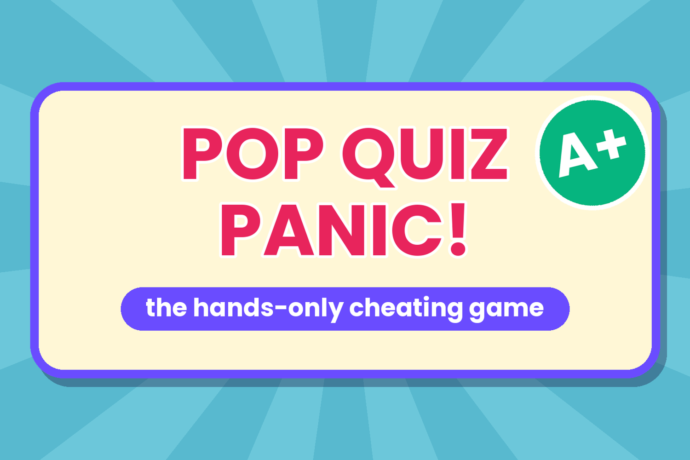
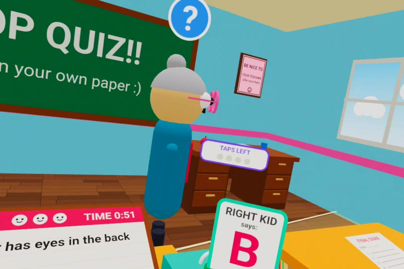
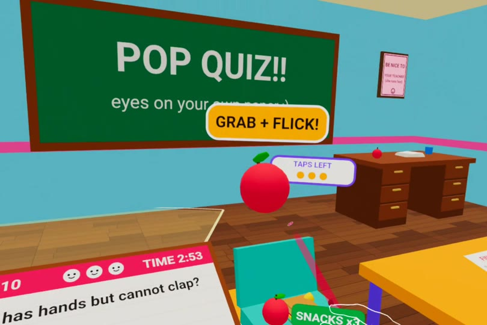
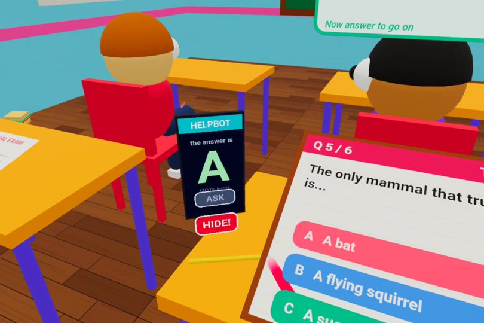
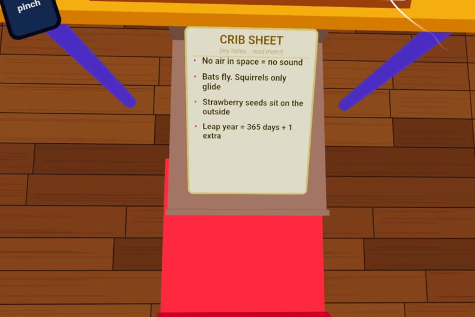
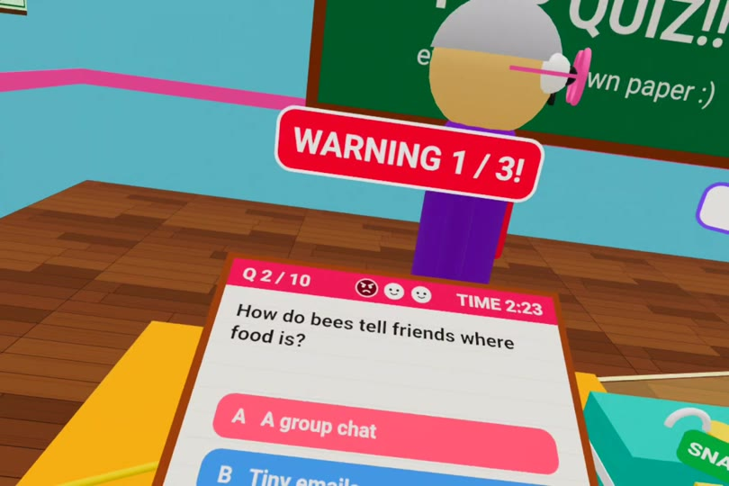
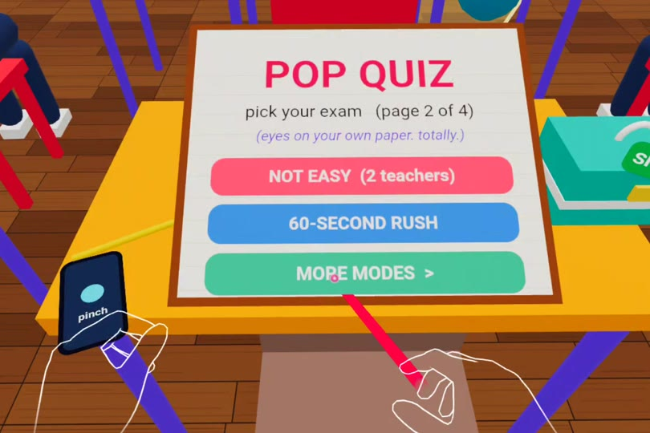

<p align="center"></p>

# Pop Quiz Panic

A goofy, seated, hands-only VR exam game for Meta Quest. The test is too hard, the teacher is watching, and the only way to pass is to cheat without getting caught. No controllers: you point and pinch.

**[Play it in the Quest browser](https://dist-silk-beta-54.vercel.app)** · **[Watch the 90-second demo](https://youtu.be/jyMtqbUCDB8)** · **[Devpost page](https://devpost.com/software/pop-quiz-panic)**

Built for the Meta VR Start Developer Competition 2026 (Gaming track).

## How to play

Open the link above in the Meta Quest browser, enter VR, sit down and put your controllers away.

| Cheat | How | The risk |
|---|---|---|
| **Peek** | Point at the kid beside you and pinch to tap their shoulder | They might be wrong, or refuse. Taps are limited. |
| **Snacks** | Pinch the lunchbox, pinch and hold a snack, swing your arm and let go | She only stays distracted for a few seconds |
| **Crib sheet** | Bend your neck and look down at the notes under your desk | She can see you looking down |
| **Phone** | Pinch the phone, pinch ASK, wait for it to load, pinch HIDE | It buffers, and if she sees it she takes it |

If the teacher spots you she turns red, charges your desk and confiscates what you were using. Three warnings and you are busted.

<p>



</p>
<p>



</p>

## Modes

- **Training Day:** a guided round that teaches one cheat per question
- **Easy:** one teacher
- **Not Easy:** two teachers
- **60-Second Rush:** beat the clock
- **Endless Survival:** keep going until you run out of lives
- **School Week:** five days, Monday to Friday, each with its own twist
- **Cheat Challenges:** Fruit Fiend, Phone Addict, Eagle Eye, Neighborhood Watch, Clean Hands

Every round draws a random seat, which changes how many neighbors you can copy from and how well the teacher sees you. Passing exams and pulling off tricks earns stickers for your sticker book.

## Comfort and accessibility

Open the settings gear between rounds: sound, music, big pop-up text, high contrast, relaxed mode (slower teacher, more time), calm motion, throw assist and seat height. Settings are saved in the browser.

The whole game is played seated, within arm's reach, and works with either hand.

## Built with

- [Immersive Web SDK (IWSDK)](https://iwsdk.dev) and WebXR
- three.js and TypeScript
- Web Audio API (all sound effects and in-game music are synthesized in code)
- Vite, hosted on Vercel

The classroom, characters, UI cards and textures are all generated in code. There are no imported models or image files in the game.

## Run it locally

Needs Node 20.19+, 22.12+ or 24+ (not 21, not 23). Check with `node -v`.

```sh
npm install
npm run dev
```

`npm run dev` opens a browser window with a Quest emulator attached, so you can play with mouse and keyboard.

| Command | What it does |
|---|---|
| `npm run dev` | start the dev server and emulator |
| `npm run typecheck` | check types |
| `npm test` | run the unit tests for the game rules |
| `npm run build` | build the `dist` folder for hosting |

To play a local build on a headset, host `dist` on any HTTPS static host and open the link in the Quest browser.

## Project layout

```
src/
  index.ts            creates the world and registers every system
  classroom.ts        the room, desks and classmates
  exam*.ts            questions, timer, answers, round flow
  teacher-*.ts        patrol route, vision and reactions
  peek*.ts            copying from a neighbor
  fruit*.ts, throw.ts lunchbox, grab-and-throw physics
  crib*.ts            the look-down crib sheet
  phone*.ts           the phone, buffering and HIDE
  modes.ts            every game mode and challenge
  seat*.ts            the random seat draw
  settings*.ts        comfort and accessibility options
  sfx.ts              synthesized sound and music
tests/                unit tests for the pure game logic
public/scenes/        the scene file
```

Files named `x.ts` hold plain game rules with no rendering, and `x-system.ts` holds the part that draws and handles input. That split is what makes the rules testable.

## Privacy

No accounts, no network calls and no tracking. Only your settings and progress are stored, in the browser's local storage.

## Credits

Game by Purav Kanda.

Demo video music: "Run Amok" by Kevin MacLeod (incompetech.com), licensed under [Creative Commons Attribution 4.0](https://creativecommons.org/licenses/by/4.0/).
